# BugBoard26

## Documento tecnico finale

**Versione 1.2 - edizione per repository pubblico**
Contributor: Giovanni Barone (`Gio0B`) e Massimo Apicella (`Modicaning`)

BugBoard26 è una piattaforma collaborativa per autenticare un team, registrare issue software, dare contesto tramite commenti e separare il lavoro attivo da quello archiviato. La consegna comprende applicazione containerizzata, persistenza Neon PostgreSQL, test JUnit 5 black-box, configurazione SonarQube, artefatti UML PlantUML, protocollo di usabilità e cronologia Git attribuita.

> Le verifiche riproducibili sono definite dalla workflow GitHub Actions. Test unitari e build vengono eseguiti su push e pull request; integrazione e analisi SonarQube sono avviabili manualmente con secret protetti. Gli esiti aggiornati sono consultabili nella sezione Actions e nessuna credenziale è inclusa nel repository o in questo documento.

# 1. Introduzione

Il prodotto risolve un problema circoscritto: mantenere una bacheca di issue comprensibile, collaborativa e storicamente integra. Non sostituisce un project manager generale e non introduce assegnazioni, notifiche, scadenze, etichette o report periodici; gli allegati sono limitati alle immagini associate alle issue.

Gli obiettivi misurabili sono: accesso controllato, creazione rapida, lista filtrabile e ordinabile, discussione persistente, archivio logico, bootstrap ripetibile con 10 issue, separazione client/API/dati e avvio tramite un comando Compose.

# 2. Analisi dei requisiti

## 2.1 Requisiti funzionali

- login e sessione JWT per e-mail/password;
- creazione utenti riservata a `ADMIN`;
- creazione issue per ogni utente autenticato;
- tipi `QUESTION`, `BUG`, `DOCUMENTATION`, `FEATURE`;
- priorità `LOW`, `MEDIUM`, `HIGH`, `CRITICAL` e stati `TODO`, `IN_PROGRESS`, `DONE`;
- lista attiva paginata con filtri e ordinamenti semantici;
- dettaglio con conversazione cronologica;
- archivio logico amministrativo e vista dedicata;
- health check comprensivo della dipendenza PostgreSQL;
- migrazioni e seed automatici/idempotenti.

## 2.2 Requisiti non funzionali

Sicurezza, portabilità, affidabilità, accessibilità e manutenibilità guidano l'architettura. Nessun segreto entra nel codice; password e token hanno gestione esplicita; input e query sono validati; il servizio usa SQL parametrizzato, TLS verso Neon, header di sicurezza, CORS e rate limit. Le immagini eseguono processi non privilegiati e hanno health check. La UI espone loading, errore, vuoto e successo, focus visibile, touch target e adattività da 320 px.

## 2.3 Requisiti di dominio

`Issue` è l'entità principale. Un bug è un valore `type=BUG`, non una sottoclasse: tipi diversi condividono attributi, commenti, ciclo di vita e policy. Ogni Issue e Comment ha un autore; nessuna entità è eliminata dall'applicazione; `archived` è indipendente dallo stato. Le date persistono in UTC e il client le localizza.

## 2.4 Attori e profili utente

`USER` rappresenta il collaboratore quotidiano: crea e consulta issue, filtra, commenta e legge l'archivio. `ADMIN` eredita queste capacità e può creare utenti e archiviare issue. Docker/operatore costituisce l'attore tecnico responsabile della configurazione e della salute del sistema.

## 2.5 Casi d'uso

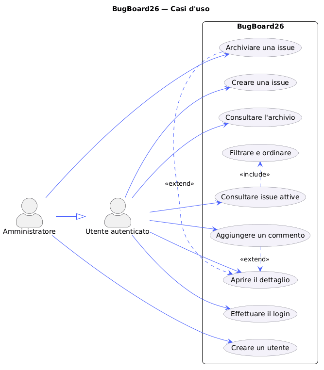

## 2.6 Casi d'uso dettagliati e mock-up

Tre schede Cockburn complete sono versionate in `documentation-workspace/requirements/use-cases.md`.

**Creare una issue.** Precondizione: sessione valida. Trigger: “Nuova issue”. Successo: Issue `TODO`, attiva e attribuita all'attore; fallimenti includono campi non validi, token scaduto e dipendenza Neon non disponibile.

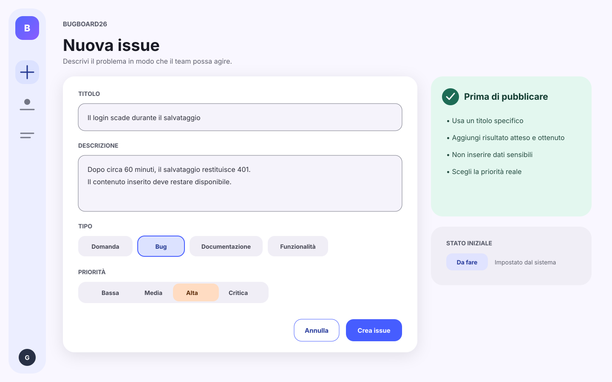

**Aggiungere un commento.** Precondizione: Issue attiva e sessione valida. Successo: testo, autore e data persistono e compaiono nella conversazione. Un archivio è leggibile ma non accetta nuove scritture.

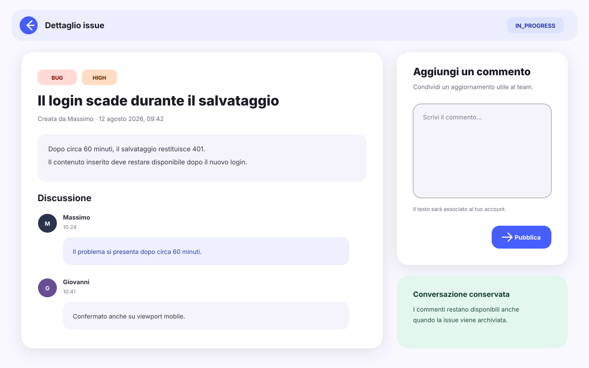

**Archiviare una issue.** Precondizione: sessione `ADMIN`. Successo: `archived=true`, uscita dalla lista attiva, presenza nell'archivio; commenti intatti. La conferma esplicita comunica che non avviene alcuna cancellazione.

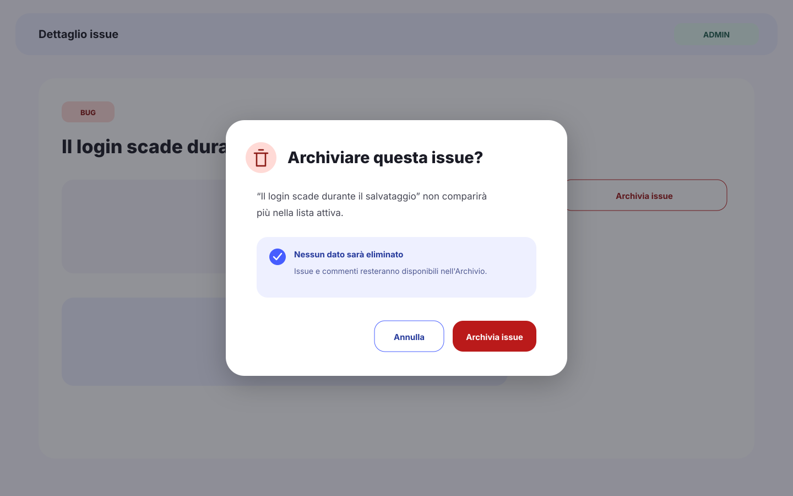

## 2.7 Valutazione dell'usabilità

Il protocollo prevede test moderato think-aloud di 20–30 minuti, 2–3 collaboratori e 1–2 amministratori/team lead, almeno una sessione tastiera e una su schermo compatto. Lo scenario attraversa login, creazione BUG HIGH, filtro, dettaglio, commento, cambio ruolo, archivio e recupero nell'archivio.

La checklist usa severità 0–4 su visibilità, corrispondenza col dominio, controllo, coerenza, prevenzione errori, riconoscimento, efficienza, essenzialità, recupero, aiuto, accessibilità e adattività. Metriche: completamento, tempo qualitativo, errori, richieste d'aiuto, SEQ 1–7 e survey finale 1–5.

**Risultati:** da raccogliere. Non sono state inventate persone, sessioni o osservazioni. Modulo, survey e criteri sono pronti in `documentation-workspace/usability/protocol.md`.

# 3. Specifica e progettazione

## 3.1 Architettura generale

React/Nginx e Express/Node sono componenti indipendenti. Il frontend legge `API_BASE_URL` da `config.js` generato all'avvio; solo il backend conosce `DATABASE_URL`. La comunicazione browser–API è JSON REST con Bearer JWT, mentre backend–Neon usa il protocollo PostgreSQL cifrato.

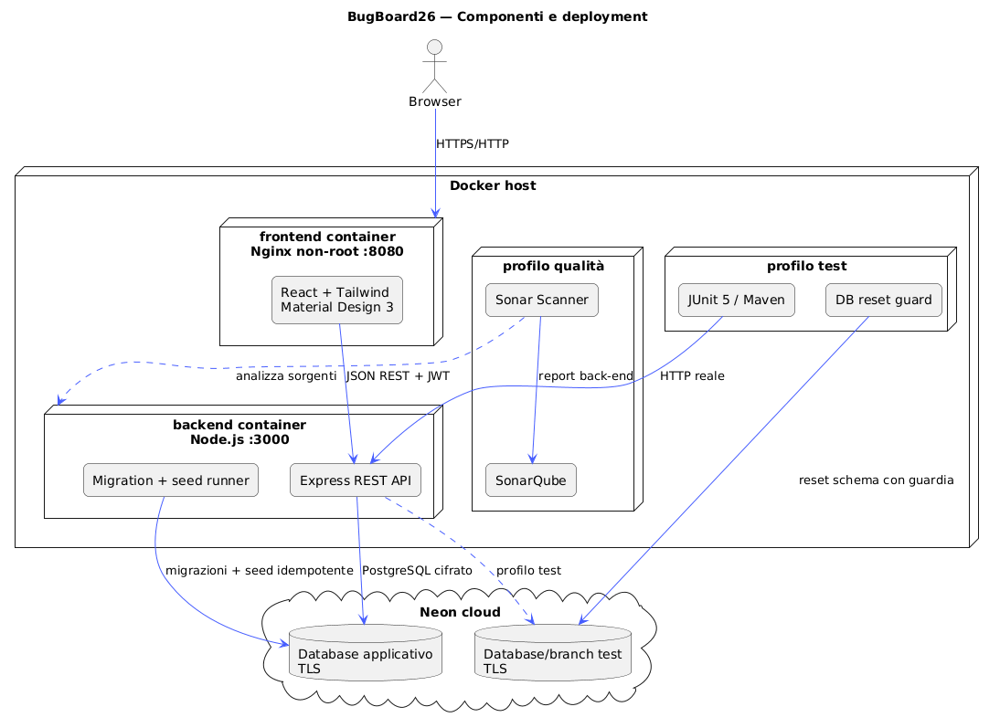

## 3.2 Scelte tecnologiche

Node 24 ed Express 5 offrono runtime LTS e HTTP minimale; Zod centralizza gli schemi; `pg` mantiene controllo SQL e compatibilità Neon. React 19, Vite 8 e Tailwind 4 separano stato/UI da business logic. Java 21, Maven e JUnit 5 soddisfano il test runner richiesto senza mock. PlantUML è il tool CASE; SonarQube Community è lo strumento qualità.

## 3.3 Frontend

Pagine: login, dashboard, creazione, dettaglio, archivio e creazione utente. `AuthContext` conserva la sessione soltanto in `sessionStorage`; `ProtectedRoute` protegge la navigazione. `apiRequest` uniforma JSON, Bearer e errori. I token Material Design 3 governano superfici, colore, shape, elevazione e focus; layout e navigation rail si trasformano su viewport compatto.

## 3.4 Backend

Il composition root costruisce repository, service, controller e middleware. I controller restano sottili; i service applicano casi d'uso e difese di dominio; i repository possiedono query parametrizzate; entity e DTO esplicitano invarianti e confini di serializzazione. Error handling e request ID sono centralizzati.

## 3.5 Docker e topologia

`docker compose up --build` avvia backend e frontend sulla rete `bugboard26-net`. Il backend valida l'ambiente, ritenta Neon, applica migrazioni, esegue seed, chiude la connessione di bootstrap e avvia il server. I profili `test` e `quality` aggiungono componenti senza introdurre PostgreSQL locale.

## 3.6 Neon PostgreSQL, modello dati e persistenza

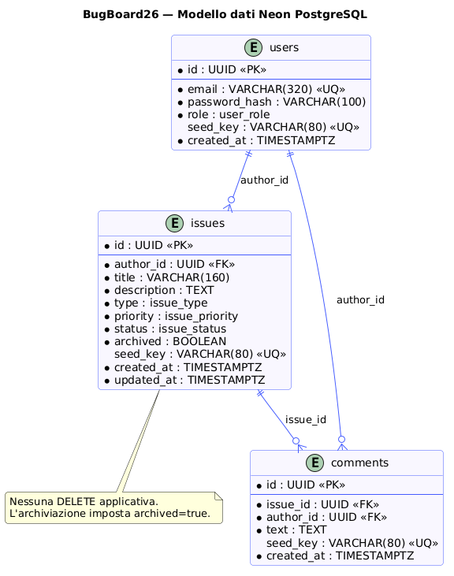

Le migrazioni SQL sono ordinate e registrate con checksum in `schema_migrations`. Advisory lock e transazioni proteggono concorrenza e fallimenti. Il seed usa UUID e chiavi stabili, `ON CONFLICT DO NOTHING`, verifica conteggi 2 utenti/10 issue/6 commenti e non cancella dati esterni.

Backup logico: usare `pg_dump` verso storage cifrato e non versionato, in coerenza con piano e policy Neon scelti. Quote, retention e compute sono dipendenze operative da verificare nella console corrente, non valori fissati dal progetto.

## 3.7 Diagrammi UML

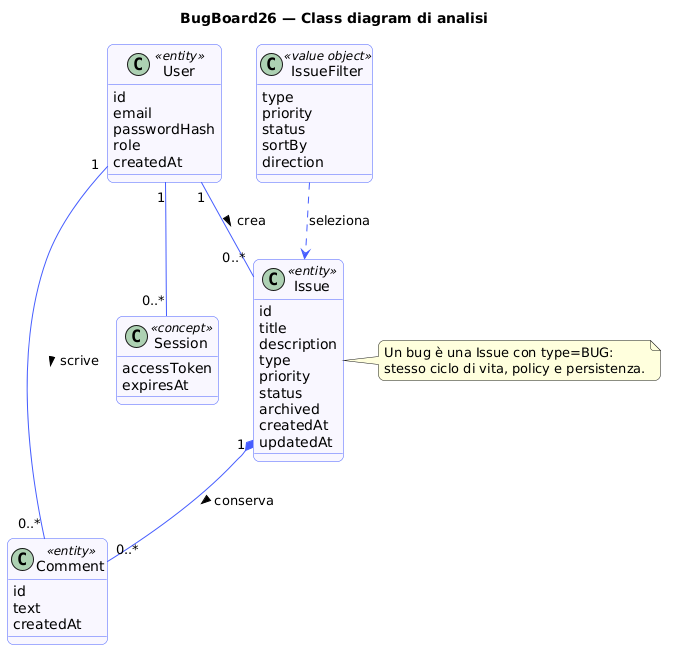

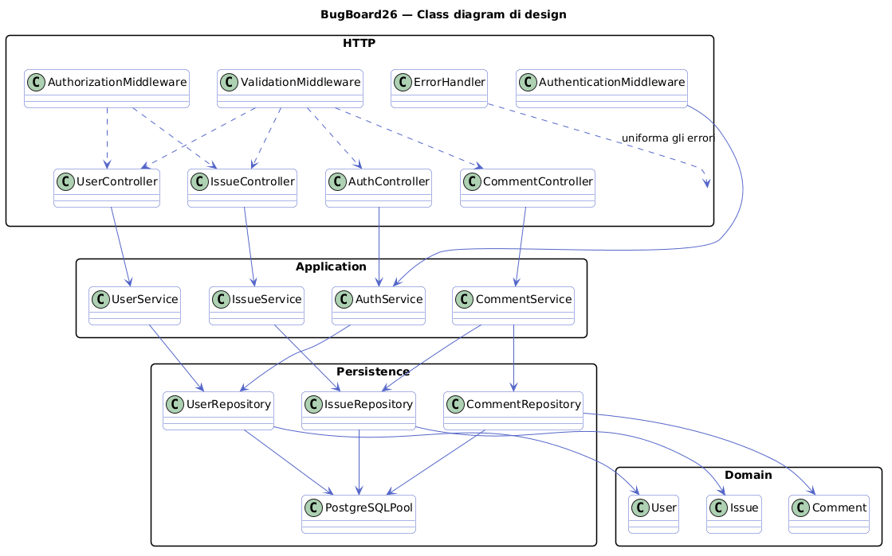

I diagrammi evidenziano modularità per layer, astrazione di Issue, dipendenze direzionali e riuso di validazione, autenticazione, paginazione e mapping. I sorgenti `.puml` permettono manutenzione e rigenerazione.

## 3.8 API REST

| Metodo | Percorso | Autorizzazione | Esito |
|---|---|---|---|
| POST | `/api/auth/login` | pubblico | JWT + User DTO |
| POST | `/api/users` | ADMIN | utente creato |
| POST | `/api/issues` | autenticato | Issue `TODO` |
| GET | `/api/issues` | autenticato | pagina attiva filtrata |
| GET | `/api/issues/archived` | autenticato | pagina archivio |
| GET | `/api/issues/:id` | autenticato | dettaglio |
| PATCH | `/api/issues/:id/archive` | ADMIN | archivio logico |
| POST/GET | `/api/issues/:id/comments` | autenticato | conversazione |
| GET | `/api/health` | pubblico | API + DB |

OpenAPI 3.1 documenta parametri, enum, schemi ed errori in `documentation-workspace/api/openapi.yaml`.

## 3.9 Sicurezza

- bcrypt con costo configurabile 10–15 e confronto dummy contro enumerazione;
- JWT HS256 con issuer, audience, subject e scadenza;
- doppio controllo ruolo: middleware e service per archivio;
- Zod strict su path/query/body, payload JSON limitato a 64 KiB;
- SQL parametrizzato; le sole parti dinamiche di sort provengono da allowlist;
- Helmet, CORS allowlist, login rate limit e Nginx security header;
- errori senza stack/query, correlati da request ID;
- segreti solo in ambiente, `.env` ignorato, processi non-root.

# 4. Design del software

## 4.1 Struttura object-oriented

Entity immutabili validano dati completi; repository mappano righe; service orchestrano regole; controller traducono HTTP; route compongono middleware; DTO impediscono l'esposizione di hash; validator definiscono i contratti; error class stabilizzano codici e status.

## 4.2 Class diagram di design

Il diagramma in 3.7 mostra che HTTP dipende dall'application layer, che dipende dalla persistenza e dal dominio. PostgreSQL non entra in controller o UI, e le dipendenze vengono iniettate dal container.

## 4.3 Sequence diagram

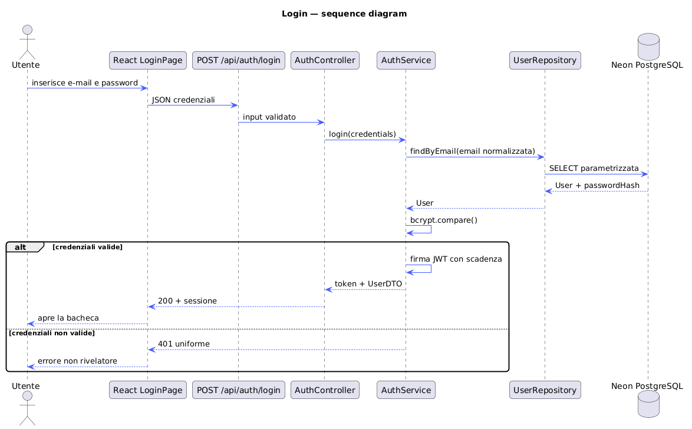

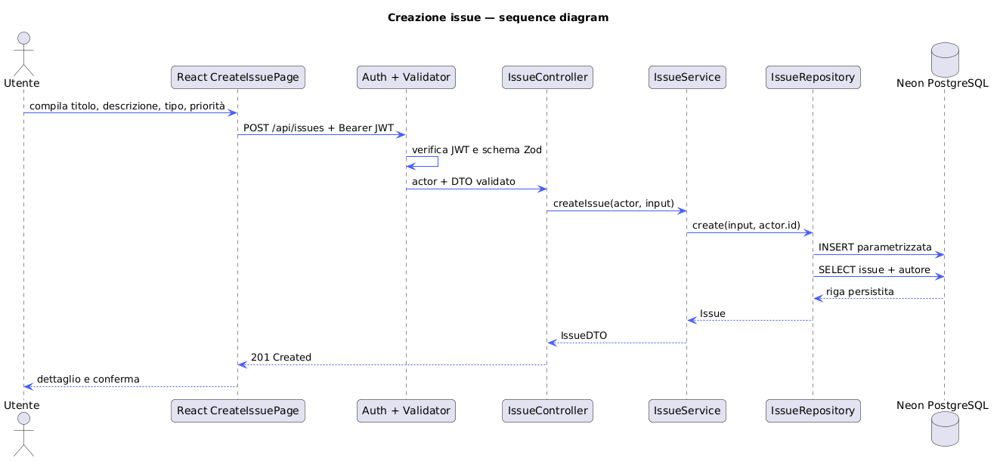

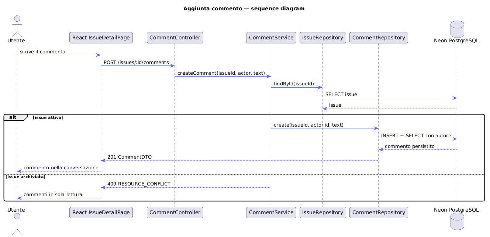

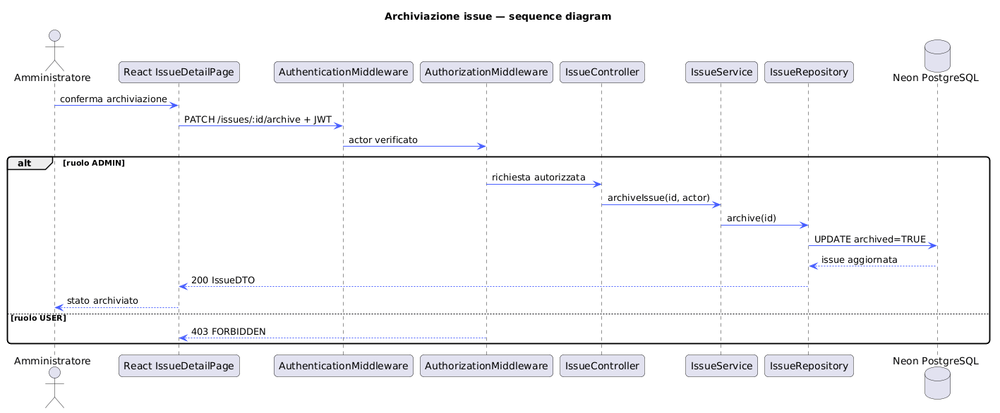

## 4.4 Controller, service, repository, entity, DTO e middleware

La separazione rende testabili i confini, centralizza autorizzazione e riduce duplicazioni. `IssueService` non costruisce SQL, `IssueRepository` non decide HTTP, il controller non applica policy, il client non decide permessi.

## 4.5 Errori e validazione

`ValidationError`, `AuthenticationError`, `AuthorizationError`, `NotFoundError`, `ConflictError` e `ServiceUnavailableError` convergono in un formato `{error:{code,message,details,requestId}}`. JSON malformato, failure DB e errori inattesi seguono percorsi espliciti.

# 5. Codice sorgente e processo di sviluppo

## 5.1 Build e avvio con Docker

Prerequisiti e comandi sono nel README. Backend e frontend hanno Dockerfile e `.dockerignore`, health check, rete dedicata e configurazione esterna. Neon non è simulato da un container PostgreSQL.

## 5.2 Repository pubblico e CI

Il progetto è distribuito tramite un repository GitHub pubblico con licenza MIT, configurazione di esempio priva di credenziali e workflow CI versionata. Test unitari e build vengono eseguiti su push e pull request verso `main`; integrazione e SonarQube richiedono un avvio manuale e secret protetti. È raccomandata la protezione di `main` con CI obbligatoria prima del merge.

## 5.3 Branch, commit, contributor e merge

`main` contiene il codice verificato; le modifiche vengono preparate su branch brevi e integrate tramite pull request. Ogni contributor usa la propria identità e le proprie credenziali Git. Alias SSH, remote personali e altre configurazioni locali non sono richiesti né documentati nel repository.

## 5.4 Migrazioni e seed

Il runner rifiuta una migrazione già applicata con checksum diverso. Seed e migrazioni usano advisory lock separati, transazioni e log sintetici. Il reset test richiede `NODE_ENV=test`, `ALLOW_TEST_DB_RESET=true`, entrambe le URL e identità DB differenti.

## 5.5 Qualità del codice

SonarQube è configurato per il solo backend. Il job manuale genera la copertura, avvia un server effimero, crea un token temporaneo, esegue lo scanner e revoca token e container al termine. Gli esiti correnti vanno consultati nella relativa esecuzione GitHub Actions; il documento non fissa valori destinati a diventare obsoleti. La revisione manuale ha eliminato duplicazione di paginazione, rafforzato invarianti Issue e uniformato request ID.

# 6. Testing

## 6.1 Strategia JUnit 5

Il container Maven usa `java.net.http.HttpClient` contro Express reale; nessun mock HTTP, repository, autenticazione o database. Il profilo crea stato noto sul DB Neon dedicato, attende l'health, ripete il seed e avvia le classi alfabeticamente.

## 6.2 Piano di test

La matrice copre login, utenti, protezione token, creazione/lista, filtri, sort, commenti, archiviazione, archivio, idempotenza e 10 issue iniziali. Parametri e classi di equivalenza sono dettagliati in `documentation-workspace/testing/test-plan.md`.

## 6.3 Casi significativi

Cinque flussi formalizzati: login/sessione; filtri/ordinamento; commento/conservazione; autorizzazione archivio; seed/isolamento. Per ognuno sono specificati obiettivo, endpoint, parametri, classi valide/invalide, atteso, ottenuto, copertura e motivazione.

## 6.4 Risultati

La workflow rende riproducibili controllo sintattico, test unitari e build del frontend. La suite JUnit manuale raggiunge l'API Express reale, applica migrazioni e seed sul target Neon dedicato e rifiuta l'esecuzione se applicazione e test usano lo stesso database. Gli esiti aggiornati e il numero corrente dei test sono consultabili nella sezione Actions.

## 6.5 Limiti

I test sono end-to-end e non misurano automaticamente la copertura statement/branch del processo Node. L'ambiente Neon introduce latenza e dipendenza di rete. Il reset è distruttivo solo sul target test e richiede consenso esplicito tramite variabile guardia.

# 7. Guida operativa e dimostrazione

1. Configurare `.env` con due target Neon distinti e credenziali demo.
2. Eseguire `docker compose up --build`.
3. Attendere health backend e frontend.
4. Accedere come USER, creare un BUG HIGH, filtrare, aprire il dettaglio e commentare.
5. Accedere come ADMIN, confermare l'archiviazione e ritrovare la discussione nell'archivio.
6. Eseguire il profilo JUnit con guardia reset.
7. Eseguire SonarQube con token locale.

Per troubleshooting e comandi completi vedere README. La checklist di consegna distingue “predisposto” da “verificato con dipendenze reali”.

# 8. Glossario

**API REST:** interfaccia HTTP JSON del backend.
**Archivio logico:** flag che rimuove una Issue dalla vista attiva senza cancellarla.
**DTO:** rappresentazione controllata in ingresso/uscita.
**Health check:** verifica processo e dipendenza DB.
**JWT:** token firmato e a scadenza.
**Migrazione:** modifica SQL versionata dello schema.
**Neon:** servizio PostgreSQL gestito esterno a Docker Compose.
**Seed:** dati dimostrativi ripetibili identificati stabilmente.
**Tool CASE:** PlantUML, usato per sorgenti e render UML.
**Quality Gate:** soglia SonarQube da verificare dopo analisi reale.
